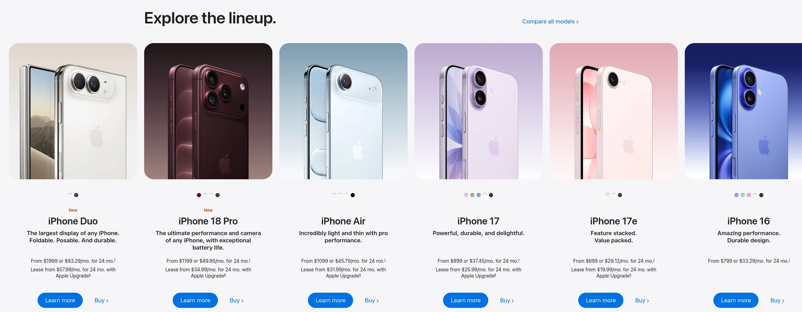
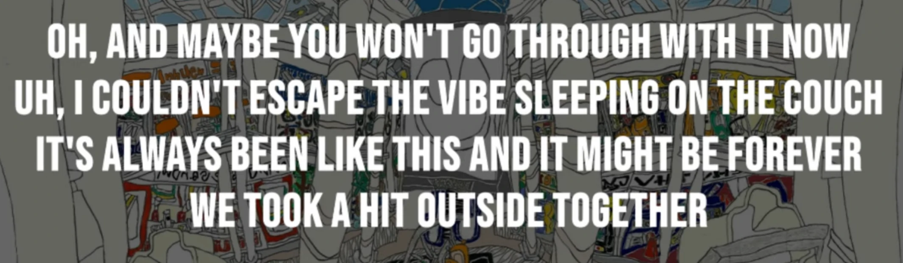
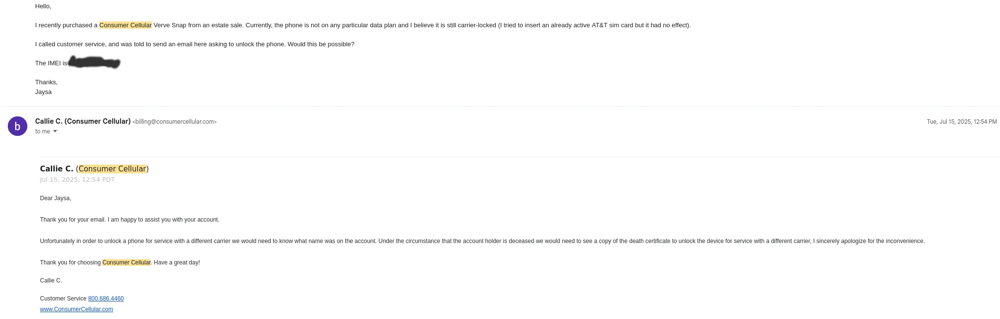
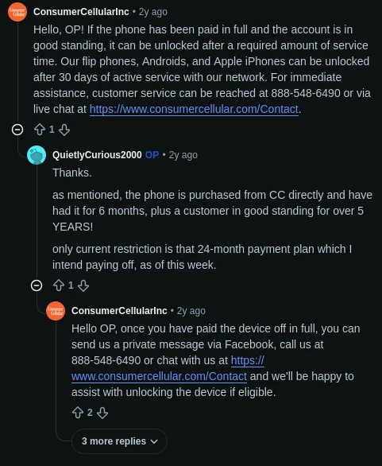
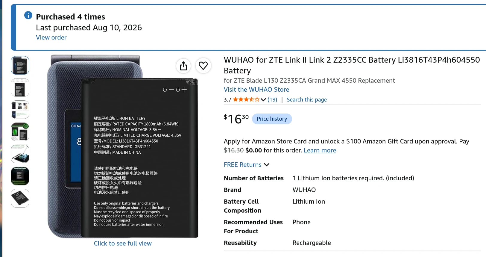
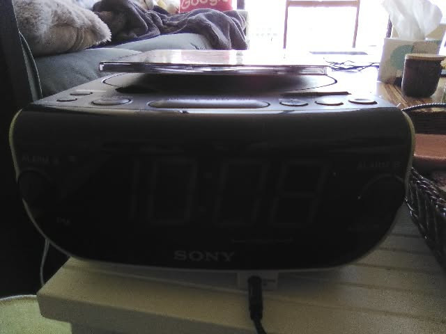
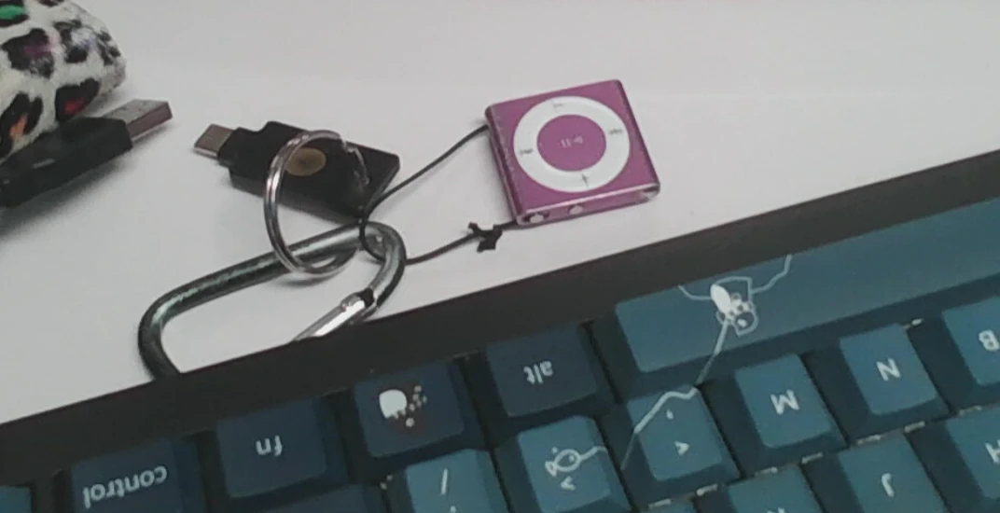
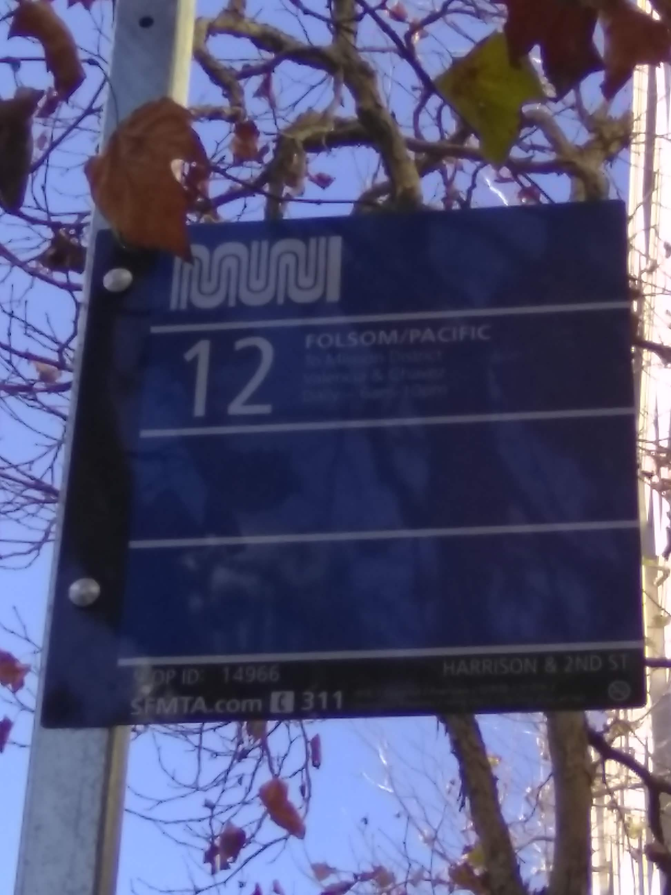
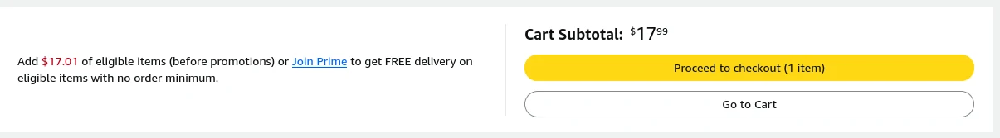

`jaysa`'s 2026 OCF Tech Talk

<!-- more -->

---

## Part 1: Blue Light Poisoning

To get us started, I'm going to play one episode of a series [`ronitnath`](https://ronitnath.com/) showed me, $uperego...

<iframe width="560" height="315" src="https://www.youtube-nocookie.com/embed/R6yZLDJMQ6I?si=Z0g2201kbxzlmjw1" title="YouTube video player" frameborder="0" allow="accelerometer; autoplay; clipboard-write; encrypted-media; gyroscope; picture-in-picture; web-share" referrerpolicy="strict-origin-when-cross-origin" allowfullscreen></iframe>

Blue light poisoning... not actually real, but also? Kind of real. Don't get me wrong, old tech is cool on its own merits. But I started seeking it out primarily to address the poisoning, among other related things. Is this going to be a phone-bad grrrr presentation? Lowkey, yeah... it's the main piece of "new tech" that affects my life, and is the comparative source of many old tech pros and cons I'll cover here.

### Screen Addiction, Planned Obsolescence, and Brokeness

!!! note "Well, I was *truly* broke in college. I'm less broke now with my big girl full-time post-grad job, but I've still gotta keep an eye on the funds."

Back before I switched to a flip phone, I used a Samsung S8 Active from about middle school until my junior year of college (the active is the same as a regular S8, but with a glued-on metal case, so it could withstand me dropping it 3x a day out of a lack of care and awareness). Unfortunately, my old smart phone was rapidly becoming less... active. Slack stopped working on it, which I used for my campus job. Then the BMO banking app stopped working, which I used to check on the money I got from said job. Random other less notable apps also stopped working because the S8 used an obsolete version of Android and was no longer receiving updates. People advised me to for the love of God buy a new phone, and I considered. But I didn't want to drop new phone money.

caption: ew

But actually, as a bit, [`oliverni`](https://oliver.ni/) had bought a brand new iphone and said I could have it. So brokeness was no longer an excuse... yet I refused it on principle. I shouldn't have to get a new phone to exist. And I understand you can't do infinite backwards compatibility forever, and I was really pushing it security-wise, but ultimately I just didn't want to support the current phone ecosystem with all its sins.

Since, from what I understand, producing new phones uses up some particularly precious natural resources and they also aren't made ethically. I also didn't like using a ton of proprietary software; I felt like I didn't have much control over the apps on my phone or how they worked, a similar frustration to what I felt using Windows before switching to Linux. So I daydreamed about buying an older Google Pixel and installing [GrapheneOS](https://grapheneos.org/), since my Samsung S8 was carrier-locked to AT&T meaning I couldn't put [LineageOS](https://lineageos.org/) (an open source android distribution) on it. It had to be an older one, since the new Google Pixels don't have headphone jacks, and I like wired earbuds because I struggle to remember to charge my devices.

--- 

So what is there to do? You can try to work around it with what you've got. Screen time restrictions, uninstalling apps, black-and-white only mode. Klarna or bum off your friends to get something that works. But honestly, these problems are so pervasive and overwhelming and when you think about everything you need to get done each day and also that you need to install an app to use transportation or eat out or see a show or log in or clock in to work and you're avoiding checking your bank account balance and your card declined but it's fine use the other one and theres a giant trash pile in your room you can't even walk through and it feels like nothing can be done and it's always been like this and it might be forever.

> "Like, even trying to figure out what's wrong with us is so exhausting we'd rather just avoid thinking about it, which is all by design."

But I want to do something about it besides take 20 xanax hit my vape and die.

## Part 2: Flip Phone Quest

So in the Spring of 2025, my ex-boyfriend (I'll specify live which one, if OCFers are curious) was driving us up to Tilden one day and I saw a sign for an estate sale. That's where I picked up my current flip phone, 2 books, and a big poster for $30. The lady hawking off dead people stuff put the poster at $20, and the phone at $5? Whatever, I didn't care, it was good enough for me. We got back to my place and we thought about making the prank call of a lifetime, since it was totally unlocked and had all the old contacts, but my morals kicked in. I deleted them and started customizing the Consumer Cellular Verve Snap. But, I soon realized it was carrier-locked to the Consumer Cellular network, so I couldn't simply swap in my AT&T SIM card.

So I forgot about this project and it sat in my drawer for a few months. But once when I was out, I was chatting with my friend's girlfriend (now also, sadly, ex-girlfriend) and realized she used a flip phone! Some kind of Nokia, with minimal features. She was from Albany and had never owned a smart phone, but got along and was able to live her life just fine... and her demonstrating it was possible was the push I needed to finish the job.

I was stumped. So I did some research, and found some hope on [a Reddit post](https://www.reddit.com/r/consumercellular/comments/1en15ov/phone_unlocking/).

Then, my morals kicked out... I called again on another day with a fresh white lie: this is an old phone I found in the drawer that I'm trying to use again, maybe it was my dad's or something, and I want to re-activate it with a consumer cellular plan! The guy, different one from last time, seemed please to get a new customer. So I got the plan for $25 or whatever, wrote down to call and unlock the phone a month from now, and lo and behold, they did! Then I de-activated my Consumer Cellular plan, swapped in my AT&T SIM from my Samsung, and have continued siphoning off my parents AT&T data plan with my same 209 number to this day. Unfortunately, they are kicking me "off the teet" at last, so I'll probably get talk and text from Tello mobile, plus 2G of data so I can receive images. I'll let you know how it goes.

I carried the Samsung S8 with me for awhile just in case I needed to switch back in some emergency, but I slowly found I could just leave it at home. So I did. I've damaged the battery in this flip phone twice. Once, I dropped my phone at [a bar in SF](https://www.jolenessf.com/) and the entire back case and battery fell off. After the bar closed, I was able to drunkenly scrounge up the back case from the floor, but the battery had disappeared. So, with a few questions to Claude, I was able to order a replacement and pop it in just fine. The second time I fried the battery, I woke up one day and knocked over a glass of water onto the phone, rendering it inoperable a few hours later. Very scary. But, it still worked plugged in, so I knew I had a chance.

[Amazon listing for the battery](https://www.amazon.com/dp/B0DQD8VWTB)

I don't remember buying it the other 2 times. I think one I have as a backup in another drawer somewhere. Guess we'll find out when I need it.

I've been using this as my only phone since last October, so it's been one full year. I've actually had *two* other people tell me that seeing me use the flip phone inspired them to also try a dumb phone: [msonmez](https://minasonmez.com/) and non-ocf person [Vera](https://reverea.dev/). Social reproduction...I have exceeded the replacement rate.

## Part 3: The Rest of My Loadout & Personal Takes

### Music: Vinyls vs. Cassettes vs. CDs vs. Digital Downloads vs. Streaming

Those are not the only four options that exist for listening to music, but they're the ones I've thought about the most. Most of the time, I listen a bunch of mp3 files in my ~/Music directory (backed up now yay) which i use a TUI music player called `ncmpcpp` to listen to. Although since I re-installed NixOS on this framework, I've just been running `firefox ~/Music` to listen on the bus or BART until I remember to set up `ncmpcpp` again.

I also have a CD collection and a Sony Dream Machine ICF-CD815 I got off ebay. It also has 2 alarms, radio, and aux for audio in. Sometimes I plug in my laptop to the audio in and use it as a speaker. It was about $30... setting both an alarm on my flip phone and the alarm clock is helpful in case one goes down for whatever reason (ex. ive had the alarm clock die from a power outage, and my phone die when i forget to charge it).

#### Portability

When I can't pull out my laptop to listen to music, I will use my beloved ipod shuffle. I have a shell script on the ipod itself that uses yt-dlp and beets to download new music, put it in my `~/Music` directory, add metadata, and put it on my ipod if it's plugged in. See [my old DeCal bash scripting lecture](https://blog.jaysa.net/2025/09/16/core-shell--bash-scripting/) for a less feature-ful version of it.

This was gifted to me for christmas at some point as a preteen, it sat in a drawer for many many years, but at some point in college I picked it up and started using it religiously until today. It has now seen so much use that the buttons are cracking!

### Video Games

If you're trying to limit doomscrolling/phone usage, setting the alternative activity to something high-willpower like Reading Russian Literature or doing more work is a good way to fail at it. So I got a 3Ds my senior year and would use it when waiting for the bus, waiting for lecture to start, sitting around before bed... I already had a steam deck, but the 3Ds is much more portable, and easy to pick up and put down. I played *a lot* of animal crossing for a few months. Now I don't. When I hit a new low, I'll begin again. I was playing that and nintendogs in japanese, so I turned it into a medium-willpower activity rather than low-willpower.

### Transportation

When I first started using my flip phone, I remember trying to navigate home from Internet Archive or somewhere with [`adymchenko`](https://anna.dymchenko.com/). She was looking up directions on her phone at this bus stop, so I wanted to be helpful. The bus sign had a phone number on it. So I called it, and asked for assistance. She asked me something along the lines of "What the hell? Are you calling the bus right now?"

'Cause it turns out: you *can* call the bus! I ended up speaking to a support agent and asking them directly for when the next bus would come that goes where we need to, who told me it'd be there in just a few minutes! But for regular use, I do the following:

1. Call 511.
2. Say "departure times" (You may have to pause for a sec before it'll pick up your voice. But you can interrupt the robot guy just fine)
3. With the numpad, type out the bus stop ID that's on the sign, then #.
4. It'll list the ETA for all the buses coming to that stop!

To supplement this, I will usually search my intended route on Google Maps on my laptop/computer before I leave a place and save it as a PDF, so I can open it up later if I get lost. I also have physical maps in my bag of San Francisco and Berkeley which I purchased from Pegasus Books on Shattuck. They come in handy, especially if I have time to write down the route in my journal before I go. Especially when I started marking them up with places. Sometimes, people will ask if I've become better at navigation since I can't use my phone for it any more. The answer is probably not, I just got more patient with myself. But in the worst case, these bay area streets are full of (mostly) nice people you can always ask for help.

You can call Ubers on the website without the app. OR, if you're beast, you'll call Uber for Seniors at 1-833-USE-UBER, give your location and payment info to the guy on the phone, and they'll send someone to grab you.

!!! warning "YOU CAN ONLY CALL UBER FOR SENIORS DURING 4:00 AM and 10:00 PM ET. In other words, it won't work from 7PM to 1AM Pacific...see the [Uber for Seniors FAQ](https://help.uber.com/en/riders/article/uber-for-seniors-faqs?nodeId=61c69dd2-22e1-4bb3-98ad-4244538ec1a8)."

I've also been meaning to hail a taxi, since I see them driving around San Francisco sometimes. But I haven't done it yet; I will get back to you. Waymo strictly needs the app I believe, so you'll have to take your friend's phone, log in with your gooogle account and add your card, and then call it. I did this last Saturday night when Muni shut down randomly from someone driving a car on the tracks.

When I'm back home and driving, I just ensure I wrote down directions. Or I call my friends and frustrate them. That's always a solid last resort when you're lost in any situation.

### Buying Shit

Use ebay!!! This is how I got my Thinkpad X220T, which carried me through my freshman and sophomore years at UC Berkeley. I was even able to buy more RAM off ebay (before the dark ages) after my CS61B Wordnet tests started freezing, since the 16GB ddr3 it came with was not enough. I ran archlinux and lived in peace until I got tired of buying new batteries, came across a thousand dollars, and bought a framework 13 I use to this day.

#### amazon moment

I am only human. Sometimes I need paper towels or trash bags or mascara delivered directly to my door. To avoid Amazon Prime, I make my orders $35+ to get free shipping (not 2-day, but still free!). So I keep a shopping list and wait until I have 3-4 things that would probably add up to $35 dollars or more... this also curbs impulse purchases for me, which is how amazon gets their money's worth when you buy amazon prime.

You can borrow someone's amazon prime instead of course, I've had friends offer very kindly, but I prefer my independence.

But when I have energy and time, I try to physically go to stores. I didn't use Grubhub or Doordash before, but when it's offered by other people, I still push to just walk and get food from somewhere. It's nice when you can try on clothes in real life anyway, or hold the thing from Target in your hands I guess. It can be awkward, and occasionally more expensive, but it's good to interact with real people and go outside probably. Are brick-and-mortar stores old-tech? I think it counts. What this looks like will be different depending on where you live and your circumstances, but since I'm reading this out loud to college kids in Berkeley, CA... it's doable for you all specifically.

## Conclusion: don't throw the baby out with the bathwater!

Not all aspects of old tech are desirable in 2026. I remember explaining to my mom how I'd gotten into collecting CDs lately, and she said it was cool, but also that back in the day, she was dying to no longer need to haul her entire collection of music around, or worry about it getting lost or damaged or stolen... and I do remember her CDs getting stolen out of her car once when I was a kid. Or my aunt's wistful response watching me peck away at my flip phone's T9 keyboard, saying "Gosh, I remember having to do that to text my friends". When my aunt and mom reflected on these things their tones were half wistful, yet thankful that things were so much more convenient now.

But all of their outdated inconveniences, to me, are quite new and exciting to puzzle about. Old tech is not strictly always better; it takes just one look at a non-backlit Game Boy screen in low light, or a new Macbook lasting day after day on one charge, to realize that. But the same goes for new, "upgraded" tech... I love headphone jacks and replaceable batteries and other old-tech pros. But I also love new tech pros like the usb-c charging standard and possessing terabytes of storage on my machines. Experimenting with old tech helps me reflect on the features, new or old alike, which I value. Tech that adds to my life, that has cool stuff and we should keep talking about and bring back. And also what aspects of tech I want to drop, that don't matter to me, that detract from me having fun.

Hopefully this tech talk helps you do the same!

I will now open the floor for people to talk about tech that they brought today or simply show it off.

<iframe width="560" height="315" src="https://www.youtube.com/embed/rg1CEKM0nd0?si=ji6VmOJ6gL0g3hxk" title="YouTube video player" frameborder="0" allow="accelerometer; autoplay; clipboard-write; encrypted-media; gyroscope; picture-in-picture; web-share" referrerpolicy="strict-origin-when-cross-origin" allowfullscreen></iframe>

## SECRET BONUS OCF PIC FROM 2022

